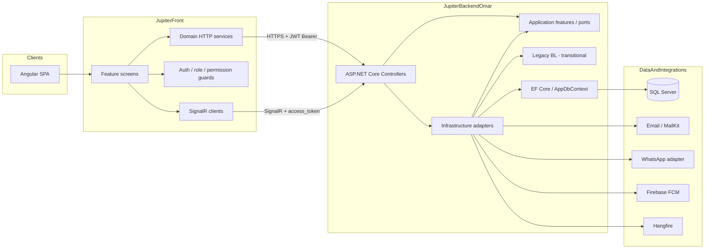
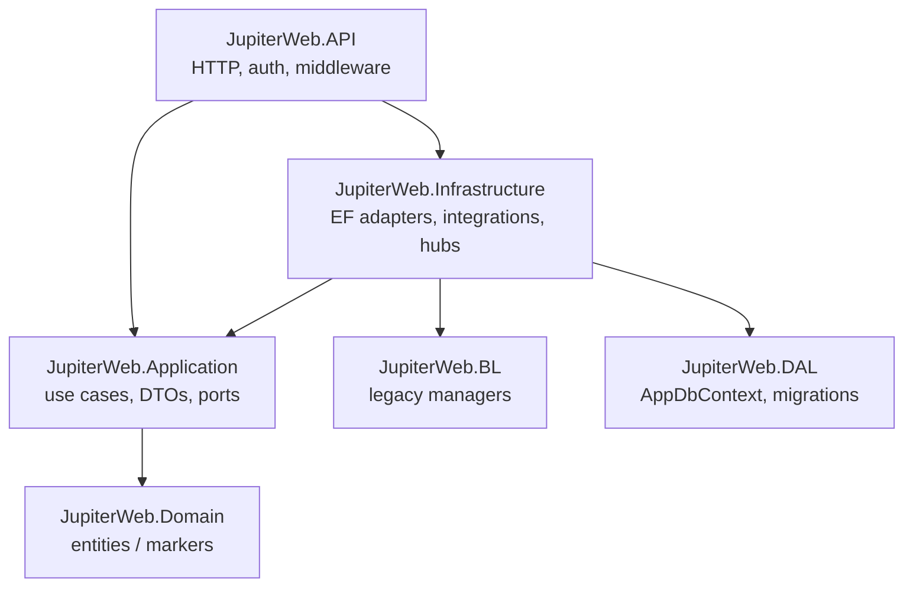
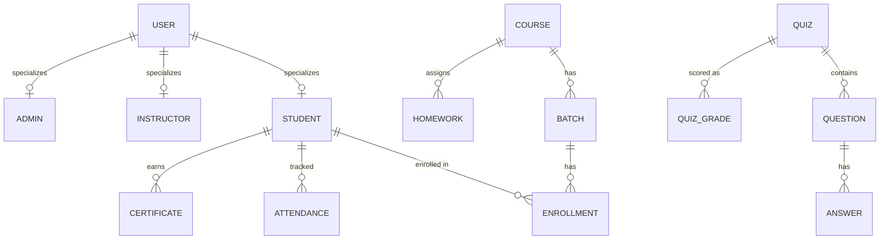
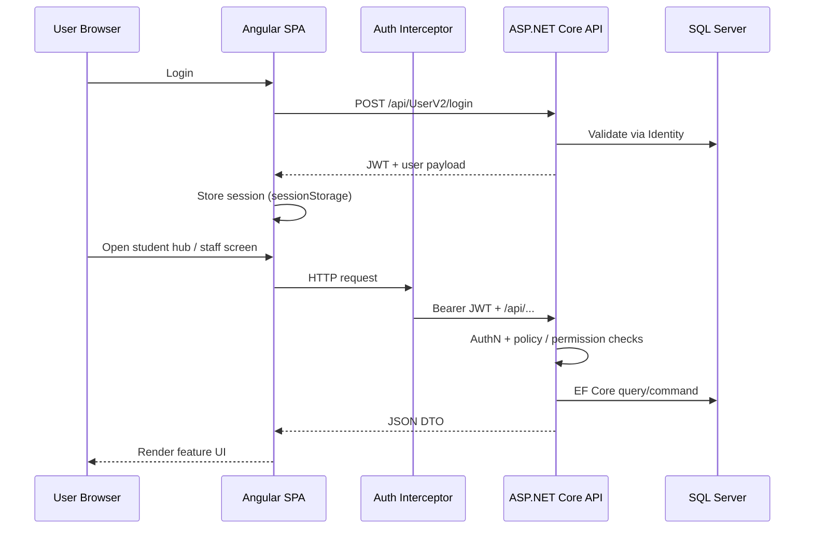

# Jupiter Educational Platform

**Full-stack educational operations platform** for managing students, courses, batches, learning activities, attendance, and related institutional workflows.

> **Portfolio case study** — This public repository documents architecture, verified capabilities, and technical decisions. It does **not** contain private application source code.

| | |
|---|---|
| **Role highlighted** | Full Stack Web Developer |
| **Primary stack** | Angular · ASP.NET Core · SQL Server |
| **Domain** | Education / EdTech operations |
| **Status** | Production-oriented system (private source) |
| **Author of this case study** | [Amira Gomaa](https://github.com/amiragomaa2597) |

---

## Table of Contents

1. [Project Overview](#1-project-overview)
2. [Project Purpose](#2-project-purpose)
3. [My Role and Contributions](#3-my-role-and-contributions)
4. [System Architecture](#4-system-architecture)
5. [Frontend Technologies](#5-frontend-technologies)
6. [Backend Technologies](#6-backend-technologies)
7. [Database Architecture](#7-database-architecture)
8. [Main Features](#8-main-features)
9. [API Architecture](#9-api-architecture)
10. [Authentication and Security](#10-authentication-and-security)
11. [Technical Challenges and Solutions](#11-technical-challenges-and-solutions)
12. [Screenshots](#12-screenshots)
13. [Demo / Live Platform](#13-demo--live-platform)
14. [Project Structure](#14-project-structure)
15. [Source Code Availability](#15-source-code-availability)
16. [Evidence Legend](#evidence-legend)

---

## 1. Project Overview

**Jupiter Educational Platform** is a modular full-stack web system used to operate an educational organization end-to-end: learner accounts, academic catalog (courses and batches), enrollments, homework and learning workflows, quizzes (including realtime participation), certificates, attendance, staff dashboards, communications, and supporting operational modules (finance, HR, competitions, and internal agile tooling).

The product is split into two private repositories:

| Layer | Private repository | Responsibility |
|-------|--------------------|----------------|
| Frontend SPA | `amiragomaa2597/JupiterFront` | Angular UI, routing, role-based screens, i18n |
| Backend API | `amiragomaa2597/JupiterBackendOmar` | ASP.NET Core API, domain services, EF Core, integrations |

Together they form a **single educational platform**, not two unrelated apps.

---

## 2. Project Purpose

The platform exists to support day-to-day educational delivery and administration:

- Give **students** a signed-in hub for batches, courses, materials access, homework, ranking/coins, and related learning flows.
- Give **instructors and managers** tools for courses, batches, enrollments, attendance, learning content, and operational oversight.
- Provide a **stable REST + realtime API** over a relational data model (SQL Server via Entity Framework Core).
- Support bilingual (English / Arabic) public and internal experiences where implemented.

This maps closely to what international educational employers expect from engineers who have maintained **real** education systems—not toy demos.

---

## 3. My Role and Contributions

### Professional profile (stated)

- Full Stack Web Developer
- Approximately **3 years** of professional software development experience
- Strong experience with **C#, ASP.NET Core, Angular, SQL Server**, and full-stack delivery on business/educational systems

### How to read this section

Local git history on both repositories shows **multiple contributors** (including Amira Gomaa / `amiragomaa2597` and other teammates). This case study therefore describes **verified platform capabilities** and a **professional full-stack contribution profile**, without claiming sole ownership of every module.

| Contribution area | Evidence basis |
|-------------------|----------------|
| Full-stack feature work across Angular + ASP.NET Core | Active commits under Amira Gomaa / `amiragomaa2597` on both repos |
| Maintaining and evolving an existing production-oriented codebase | Ongoing commits; architecture migration notes in backend |
| Educational domain features (students, courses, batches, learning, attendance) | Implemented controllers, services, entities, and Angular feature routes |
| Auth, permissions, and secure API consumption | JWT + Identity + policy providers (backend); interceptors + guards (frontend) |
| Architecture modernization (Clean Architecture-style layers) | Application / Infrastructure / Domain projects and migration documentation |

**Needs confirmation (not asserted as exclusive ownership):** exact ownership percentage per feature, product ownership, DevOps/hosting ownership, and which screenshots represent personal vs team work.

---

## 4. System Architecture

### High-level architecture



### Backend layering (modular monolith)

The backend follows an **N-Tier modular monolith** with Clean Architecture dependency rules, while legacy `BL` / `DAL` remain during incremental migration.



**Verified:** Controllers are organized by domain folders (`Academic`, `Learning`, `People`, `Auth`, `Attendance`, `Communications`, …). Application feature modules exist under `JupiterWeb.Application/Features/` (50+ feature folders). Thin controllers call Application/Infrastructure services rather than embedding all business logic.

### Frontend communication pattern

1. Angular domain services call `environment.apiBaseUrl` + `/api/{Controller}/...`.
2. `AuthInterceptorService` attaches `Authorization: Bearer <JWT>`.
3. Route guards enforce student / instructor / manager / permission access.
4. Realtime notifications connect to SignalR hubs on the same API host (e.g. `/notifications`); quiz realtime uses `QuizHub` mapped at `quizhub`.

**Production API base (from frontend prod environment):** `https://api2.jupitersoftware.net`  
**Public site origin (from SEO config):** `https://jupitersoftware.net`

---

## 5. Frontend Technologies

| Technology | Verified detail |
|------------|-----------------|
| **Angular** | 18.x (`@angular/*` ^18.2) |
| **Language** | TypeScript |
| **UI** | PrimeNG 17, Angular Material (date modules), Bootstrap 5, ng-bootstrap |
| **State / HTTP** | RxJS, `HttpClient`, domain services under `Services/{domain}/` |
| **Auth client** | `jwt-decode`, session-stored user session, Bearer interceptor |
| **Realtime** | `@microsoft/signalr` (notifications hub) |
| **i18n** | `@ngx-translate` with English + Arabic dictionaries and RTL support |
| **Other** | Chart.js, QR (`angularx-qrcode`, ZXing), Leaflet, xlsx, DOMPurify for sanitized HTML |

**Architecture style (frontend):** NgModule-based app (`AppModule`), feature screens under `features/{domain}/`, reusable UI under `shared/components/`, DTOs under `_models/{domain}/`, HTTP under `Services/{domain}/`. List screens increasingly use a shared `app-data-view` pattern.

---

## 6. Backend Technologies

| Technology | Verified detail |
|------------|-----------------|
| **Runtime** | .NET 7 (`net7.0`) |
| **Web** | ASP.NET Core (minimal hosting in `Program.cs`) |
| **ORM** | Entity Framework Core 7 |
| **Database (runtime)** | SQL Server (`UseSqlServer`) |
| **Identity** | ASP.NET Core Identity (`User` + `IdentityRole<string>`) |
| **Auth** | JWT Bearer (`Microsoft.AspNetCore.Authentication.JwtBearer`) |
| **Realtime** | ASP.NET Core SignalR (including `QuizHub`) |
| **Jobs** | Hangfire (+ SQL Server storage package) |
| **Docs** | Swashbuckle / OpenAPI |
| **Email** | MailKit |
| **Push** | Firebase Admin (FCM adapter) |
| **PDF / images** | iTextSharp, QuestPDF, ImageSharp |
| **Tests** | xUnit, Moq, `Microsoft.AspNetCore.Mvc.Testing` |

**Note:** MySQL-related NuGet packages exist in the solution, but the verified host configuration path uses **SQL Server** (plus in-memory DB for testing).

---

## 7. Database Architecture

### Persistence model

- **DbContext:** `AppDbContext` extends `IdentityDbContext<User, IdentityRole<string>, string>`.
- **Migrations:** present under `JupiterWeb.DAL/Migrations/` (dozens of migration files).
- **User model:** table-per-hierarchy (TPH) discriminator for `Student` / `Instructor` / `Admin`.
- **Soft delete:** `SaveChanges` handles `ISoftDeletable` entities.

### Core educational relationships (verified)



**Educational / learning entities present in `AppDbContext` (non-exhaustive):**  
`Students`, `Courses`, `CourseCategories`, `Batches`, `Enrollments`, `Homework`, `Quizzes`, `Questions`, `Answers`, `quizGrades`, `Certificates`, `Attendances` / `Attends`, `CoinsLog`, `Prizes`, `Rules`, plus branches, interviews, notifications, finance, competitions, HR-related sets, and more.

---

## 8. Main Features

Legend: **Verified** = found in source. **Needs confirmation** = partial evidence or product wording that should be validated with stakeholders before CV claims.

### Education capabilities mapped to employer expectations

| Employer expectation | Status | Evidence summary |
|---------------------|--------|------------------|
| Student dashboards / learner hub | **Verified** | Angular `student` route + `StudentComponent` (batches, courses, enrollments, prizes/coins); role `studentGuard` |
| Educational content & course management | **Verified** | Courses/batches APIs + Angular courses/materials/upload routes |
| Assignments / homework | **Verified** | `HomeworksController` + homework upload / student homework routes |
| Online exams / quizzes | **Verified (backend + model); UI partial** | Quiz/Question CRUD APIs; SignalR `QuizHub` for join/ready/start/submit; dedicated quiz route not found in current frontend routing snapshot |
| Student & user management | **Verified** | Students/Instructors/Admins/Users controllers + staff list views (`app-data-view`) |
| Backend APIs | **Verified** | ~70+ controller classes, domain-grouped REST surface |
| Database design | **Verified** | Rich EF model + migrations + Identity integration |
| Full-stack architecture | **Verified** | Angular SPA ↔ ASP.NET Core API ↔ SQL Server |
| Maintaining / improving existing systems | **Verified** | Incremental Clean Architecture migration; V2 controllers; ongoing feature work |

### Feature highlights (verified)

**Academic operations**

- Courses (including public `dashboard-courses` catalog endpoint)
- Batches / timetables / activity updates
- Enrollments (CRUD, bulk, student-batch queries)
- Branches and instructor availability / makeup sessions (API present)

**Learning & assessment**

- Homework upload and management
- Quiz and question management APIs
- Realtime quiz participation via SignalR (`QuizHub`)
- Certificates publishing workflow
- Coins / prizes / rules (gamification-style learning incentives)

**People & access**

- Student registration requests
- Instructor and admin management
- Role-aware dashboards (admin / instructor routes on frontend)

**Attendance**

- Attendance APIs and Angular attendance / QR-related routes

**Communications**

- In-app notifications + SignalR notification hub
- Email flows (including forgot-password OTP endpoints)
- WhatsApp staff tooling (admin/manager policy)
- FCM token update endpoint (server-side Firebase integration)

**Additional platform modules (verified, secondary for EdTech CV focus)**

- Finance / transactions
- HR attendance and leave modules
- Competitions (seasons, teams, scoreboard, registration)
- Internal agile project/sprint/task tooling
- Public marketing / software showcase pages and SEO metadata

---

## 9. API Architecture

### Style

- REST controllers under `api/[controller]` (with some versioned routes such as `api/Notifications/v2`, `StudentV2`, `BatchesV2`, `UserV2`).
- Controllers grouped by domain folders for maintainability.
- Application feature services / ports for migrated use cases; legacy BL still used where migration is incomplete.
- Centralized exception middleware maps application exceptions to HTTP status codes without leaking internals in production.

### Representative educational endpoints (verified samples)

| Area | Examples |
|------|----------|
| Auth | `POST api/UserV2/login`, password change, user listing |
| Students | `api/Student`, `api/StudentV2` (list/create/update/delete, coins) |
| Courses | `api/Courses` (+ `dashboard-courses`, levels/sessions/materials permissions) |
| Batches | `api/Batches`, `api/BatchesV2` (dashboard, timetable, CRUD) |
| Enrollments | `api/Enrollments` (CRUD, bulk, `student-batches/{std_id}`) |
| Homework | `api/Homeworks` (by course/batch, upload endpoints) |
| Quiz | `api/Quiz`, `api/Questions`, SignalR hub `quizhub` |
| Certificates | `api/Certificates` (CRUD + publish) |
| Attendance | `api/Attendances`, `api/Attendan` |
| Notifications | `api/Notifications`, `api/Notifications/v2`, FCM token update |

### Frontend ↔ backend contract



---

## 10. Authentication and Security

**Only verified controls are listed.**

| Control | Verified implementation |
|---------|-------------------------|
| Authentication | ASP.NET Core Identity + JWT Bearer |
| Password handling | Identity `UserManager` password pipeline (not custom plaintext storage) |
| Default API posture | Fallback authorization policy requires authenticated user |
| Role policies | `AdminOnly`, `ManagerOnly`, `AdminOrManager`, instructor/student combinations, HR-related policies |
| Fine-grained permissions | Dynamic `PermissionPolicyProvider` (`perm:...` style policies used by controllers) |
| Frontend enforcement | Auth guard + role guards + permission guard; Bearer interceptor |
| Token transport for hubs | SignalR `access_token` query handling for hub paths |
| Session storage (FE) | User session in `sessionStorage` (with migration notes away from `localStorage` for tokens) |
| HTML safety (FE) | DOMPurify used with trusted HTML patterns |
| Secrets | Backend guidance to keep secrets out of committed config (User Secrets / local / env) |
| Error hygiene | Exception middleware avoids leaking internal details in production |
| Rate limiting | Rate limiter configured in API host pipeline (specific policy present) |

**Not verified in source:** refresh-token rotation (no `RefreshToken` matches found). Do not claim refresh tokens on a CV unless added later.

---

## 11. Technical Challenges and Solutions

Only challenges with clear code/architecture evidence:

| Challenge | Solution evidenced in codebase |
|-----------|--------------------------------|
| Growing monolith with mixed legacy layers | Incremental migration to Application ports + Infrastructure adapters while keeping BL/DAL transitional |
| Multi-role educational product (student / instructor / admin / manager) | JWT claims + named policies + dynamic permission policies; mirrored by Angular guards |
| Realtime learning interactions | SignalR `QuizHub` for join/ready/start/answer flows backed by quiz persistence services |
| Operational notifications at scale | Notifications APIs + SignalR hub + FCM adapter + Hangfire for background work |
| Bilingual audience (EN/AR) | ngx-translate dictionaries, RTL language service, bilingual SEO metadata |
| Large list/admin UX consistency | Shared `app-data-view` component and config pattern for staff list screens |
| Keeping public marketing pages discoverable while protecting private app areas | `SeoService` + public SEO route data; private routes left noindex via private SEO behavior |

---

## 12. Screenshots

Screenshots are **intentionally not published** in this repository yet.

Reason: screens from a live educational system often contain student names, phone numbers, payments, or internal staff data. Publishing them without a privacy review would be inappropriate for a public GitHub portfolio.

### How to add safe screenshots later

1. Capture screens with **synthetic / anonymized data only**.
2. Blur or remove PII (names, phones, emails, amounts, IDs).
3. Place files under `assets/screenshots/`.
4. Link them in this section.

Suggested safe set (after anonymization):

- Student hub (batches overview)
- Course / materials screen
- Homework upload flow
- Attendance view
- Admin or instructor dashboard (no real people)

See [`assets/screenshots/README.md`](assets/screenshots/README.md).

---

## 13. Demo / Live Platform

| Resource | URL | Notes |
|----------|-----|-------|
| Public website origin | https://jupitersoftware.net | Present in frontend SEO configuration |
| Production API host | https://api2.jupitersoftware.net | Present in `environment.prod.ts` |

**Important:** Private authenticated areas require credentials and must not be shared publicly. This portfolio does not include demo logins. If a scrubbed demo environment is created later, add it here.

---

## 14. Project Structure

### This public portfolio repository

```text
Jupiter-Educational-Platform/
├── README.md                          # This case study
├── docs/
│   ├── ANALYSIS-SUMMARY.md            # Verified vs needs-confirmation matrix
│   ├── CV-INTEGRATION.md              # Ready-to-paste CV bullets
│   ├── architecture/
│   │   └── OVERVIEW.md                # Architecture notes
│   └── features/
│       └── EDUCATION-FEATURES.md      # Education feature evidence map
├── assets/
│   └── screenshots/
│       └── README.md                  # Screenshot policy
└── .github/
    └── FUNDING.yml.example            # Optional; not enabled
```

### Private source layout (documented, not published)

**Frontend (`JupiterFront`)**

```text
src/app/
├── features/{domain}/          # Routed screens
├── Services/{domain}/          # HTTP / domain logic
├── _models/{domain}/           # DTOs / view models
├── shared/components/          # Reusable UI (data-view, layout, ...)
├── dialogs/                    # Modal flows
├── guard/                      # Route guards
└── app.module.ts / app-routing.module.ts
```

**Backend (`JupiterBackendOmar`)**

```text
JupiterWeb.API/                 # Controllers, middleware, Program.cs
JupiterWeb.Application/         # Features, ports, DTOs
JupiterWeb.Domain/              # Domain types
JupiterWeb.Infrastructure/      # EF adapters, integrations, hubs
JupiterWeb.DAL/                 # AppDbContext, migrations (legacy/transitional)
JupiterWeb.BL/                  # Legacy managers (transitional)
JupiterWeb.Tests/               # Automated tests
```

---

## 15. Source Code Availability

| Repository | Visibility | Contents |
|------------|------------|----------|
| **This repo** (`Jupiter-Educational-Platform`) | **Public** | Architecture case study and documentation only |
| `amiragomaa2597/JupiterFront` | Private | Angular application source |
| `amiragomaa2597/JupiterBackendOmar` | Private | ASP.NET Core API source |

Private source is **not** mirrored here by design (IP protection, student data risk, and secret hygiene).

Recruiters and engineering managers can evaluate:

- Domain fit (real educational platform)
- Stack fit (Angular + ASP.NET Core + SQL Server)
- Architectural maturity (modular monolith, auth/permissions, integrations)
- Maintenance experience (migration and multi-module product)

For a technical interview, deeper walkthroughs can be arranged under NDA if required by the employer.

---

## Evidence Legend

| Label | Meaning |
|-------|---------|
| **Verified** | Directly observed in repository source during analysis |
| **Inferred** | Reasonable architectural interpretation; not over-claimed in CV bullets |
| **Needs confirmation** | Partial evidence or ownership/product claim that the author should confirm before stating publicly |

---

## License

No open-source license is attached to this documentation repository.  
All rights to the underlying Jupiter software remain with their respective owners.  
This public material is provided for **professional portfolio / recruitment** purposes.

---

## Contact

GitHub: [@amiragomaa2597](https://github.com/amiragomaa2597)
